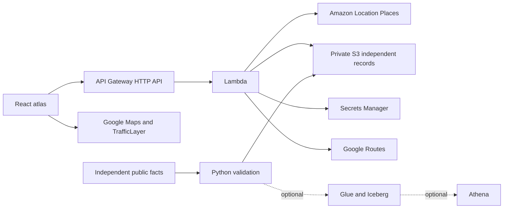

# Architecture

The browser has three deliberately distinct sources of information:

This diagram describes implemented deployment paths, not an assertion that cloud resources are active. In the current unconfigured demo, the browser loads its bundled independent snapshot and OSM map, and runs the planning model locally.

## API contracts

All paths below are relative to `/api`. Responses are `no-store`.

| Endpoint                            | Responsibility                                                                 |
| ----------------------------------- | ------------------------------------------------------------------------------ |
| GET `/health`                       | Configuration flags only; not an upstream readiness probe                      |
| GET `/facilities`                   | Read `validated/facilities.json` from private S3, add actual delivery metadata |
| GET `/communities`                  | Read `planning/communities.json` from S3                                       |
| GET `/aws/nearby?lat=&lng=&radius=` | SearchNearby, hospital category, PAK filter, SingleUse                         |
| GET `/aws/search?lat=&lng=&text=`   | SearchText with bias, PAK filter, bounded query length                         |
| POST `/routes/matrix`               | Origin + 1–12 independent human-hospital IDs; traffic-aware matrix             |
| POST `/routes/selected`             | Origin + independent human-hospital ID; route polyline and traffic intervals   |

Coordinates are constrained to the Lahore study extent. Candidate destinations are resolved from S3, never arbitrary user URLs. Errors do not expose provider credentials. Browser requests time out after 15 seconds; provider requests after 12 seconds. API Gateway throttles to two requests/second with five-request burst, Lambda concurrency to three. No request-body logging is configured. Lambda reads only the two independent dataset keys and the explicitly supplied Routes secret. Places actions are restricted to the region's default provider resource.

## Source and display separation

AWS discovery responses are session-only results with attribution and unknown care suitability. They do not become verified facility records. No discovery result is plotted on Google Maps or OSM; only independently sourced coordinates are plotted. Independent facts alone enter S3 and the optional Iceberg table.

Google computeRouteMatrix gives duration/distance, not route geometry. The selected computeRoutes call returns a separate encoded polyline, static baseline and optional speed intervals. A missing route, matrix error or missing interval remains explicitly missing. Google geometry never appears on the OSM fallback. No Google route/traffic data is written to S3 or Iceberg.

Amazon Location's published Pakistan coverage distinguishes Places from map/routing coverage. The architecture therefore uses Places for discovery and Google for its own traffic/routes, subject to actual provider availability. [AWS coverage](https://docs.aws.amazon.com/location/latest/developerguide/data-quality.html), [SearchNearby](https://docs.aws.amazon.com/location/latest/developerguide/search-nearby.html), [Google traffic intervals](https://developers.google.com/maps/documentation/routes/traffic_on_polylines), [Google Routes policies](https://developers.google.com/maps/documentation/routes/policies), [AWS service terms](https://aws.amazon.com/service-terms/).

## Planning calculation

Independent origin and facility coordinates define a synthetic path via one Ravi crossing anchor when sides differ. Geographic distance × 1.35 / 20 km/h + four minutes gives modeled travel time. These are testable assumptions, not a road-network or clinical survival model. A crossing closure means no model path. An upgrade changes one facility's scenario eligibility. The gauge counts sample origins with any eligible modeled journey within the chosen threshold. No population interpolation, continuous coverage boundary or clinical safe-time boundary is drawn.

## Design implementation

[Figma](https://www.figma.com/design/YW6WtWs7SMQb0aGdPstddh) contains editable desktop/mobile frames and a state specification. `design/create.js` preserves the native-layer construction source. The React build implements the warm cream/amber bento layout, reusable button styles, dominant map, semicircular gauge, dark directory and source-flip interaction. The responsive app adapts the conceptual Figma map into functional map-provider components.

## Remaining verification

Deploy SAM, upload independent data, enable Google APIs and restrictions, rebuild with frontend configuration, and verify actual Places, S3 and Routes responses. Optional Iceberg and Athena need their own cloud deployment checks. No model or provider integration is represented as verified merely because its code compiles.
