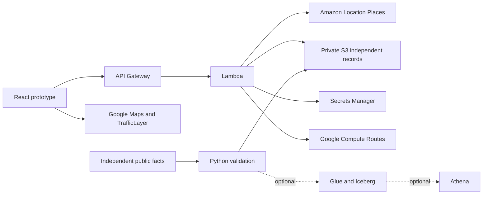

# Architecture

VenomLink separates independently sourced facility facts, provider discovery, real road estimates and hypothetical planning assumptions.

## Deployed paths

The Sydney deployment has been verified through actual S3 facility delivery, Amazon Location responses, and a selected Google route proxied through Lambda. The selected route returned geometry, driving duration/distance and speed intervals. The no-billing Google Maps Demo Key renders the map. Native computeRouteMatrix rejected this key because that method requires billing; it is **not used in demo mode**. Optional Glue/Iceberg/Athena and a trained image classifier are not deployed.

| Endpoint relative to /api | Responsibility                                                                                   |
| ------------------------- | ------------------------------------------------------------------------------------------------ |
| GET /health               | Configuration flags only, not an upstream readiness probe                                        |
| GET /facilities           | Read validated/facilities.json from private S3 with actual delivery metadata                     |
| GET /communities          | Read planning/communities.json from S3                                                           |
| GET /aws/nearby           | SearchNearby with hospital categories, PAK country restriction and SingleUse                     |
| GET /aws/search           | SearchText with geographic bias, PAK restriction and bounded text                                |
| POST /routes/selected     | Resolve an independent hospital ID and request a traffic-aware Compute Routes polyline           |
| POST /routes/matrix       | Demo mode: at most five supported Compute Routes calls; standard mode: native computeRouteMatrix |

## Constraints and lifecycle

Coordinates are constrained to the Lahore study extent. Destinations resolve from the independent S3 dataset and exclude reference institutions. Demo comparisons reject duplicate IDs and more than five candidates before making provider calls. Individual failures remain unavailable. Comparisons are on demand in demo mode, with superseded browser requests canceled. Selected-route automatic refresh occurs only while visible, at five-minute intervals by default. The map and selected-route traffic updates are independent.

Responses are no-store. Provider requests time out after twelve seconds, browser requests after fifteen. API Gateway throttles to two requests/second with a five-request burst. Reserved Lambda concurrency is optional and omitted for small initial account limits; account-level concurrency still applies. The function reads only the two validated S3 keys and the explicitly supplied route secret. Exact published and local-development origins are allowed; CORS is not authentication. No request-body/location logging is configured.

AWS results remain session-only, attributed and unplotted on third-party maps. A provisional name/distance match does not become a verified independent record. In live checks, hospital-category searches returned zero results while SearchText returned the Shahdara locality. The UI explains the difference between a coverage gap, a geographic reference and a medical facility. The PAK restriction is retained; nearby cross-border results are not substituted for missing Lahore hospital matches.

Google route content stays ephemeral and appears only on Google Maps. No route or discovery content enters the independent S3/Iceberg dataset. Missing speed intervals never produce invented traffic colors. A failed Google map falls back to OSM and independent illustrative paths; Google geometry is not drawn there.

## Planning calculation

The separate illustrative model uses geographic segments, one crossing anchor, distance × 1.35 / 20 km/h + four minutes. A selected hypothetical crossing delay adds twenty minutes only where that path crosses. Closure removes those connections. Upgrade changes only shahdara-thq eligibility. The gauge counts sample communities within the chosen threshold. It does not measure population coverage, a survival boundary, verified treatment access, or a continuous travel-time polygon. Scenarios do not modify Google's reported routes.

## Reuse and limits

The Free-plan deployment helper verifies an active FREE AWS plan with sufficient credits before deployment. It never upgrades the account or enables Google billing. The Maps Demo Key is only for evaluation/testing and can stop when its usage cap is reached. [Demo-key guide](https://developers.google.com/maps/documentation/javascript/demo-key), [demo terms](https://cloud.google.com/terms/maps-platform/demo-project-terms), [AWS Free plan](https://docs.aws.amazon.com/awsaccountbilling/latest/aboutv2/free-tier-plans.html).

[Figma](https://www.figma.com/design/YW6WtWs7SMQb0aGdPstddh) contains editable desktop/mobile layouts and state notes; design/create.js preserves the native-layer construction source. The app implements the cream/amber bento layout, map, gauge, dark directory and actual source-flip interaction.
